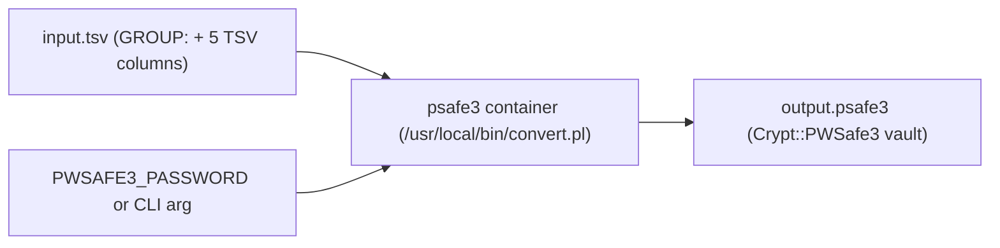

# pwsafe3

Dockerized Perl utility converting grouped tab-separated credential entries ([`input.tsv`](input.tsv)) into encrypted Password Safe v3 (`.psafe3`) vaults using `Crypt::PWSafe3`.

> **Documentation Portal:** [docs/index.md](docs/index.md) ([Tutorials](docs/01-tutorials/index.md), [How-To Guides](docs/02-how-to-guides/index.md), [Reference](docs/03-reference/index.md), [Explanation](docs/04-explanation/index.md))

## Workflow Overview



## Input Format (`input.tsv`)

Despite earlier notes mentioning CSV, `convert.pl` parses **tab-separated values (TSV)** organized by `GROUP:<GROUP_NAME>` section headers:

```text
GROUP:APP_TESTING
appbddlir1	calcul	apps_ro	ro	example-placeholder-secret
```

| Column Index | Field | Vault Mapping |
| :--- | :--- | :--- |
| `0` | Server / host | `title` + `notes` (`Server:`) |
| `1` | Database name | `user` suffix (`@<db>`) + `notes` (`Database:`) |
| `2` | Account name | `user` prefix (`<user>@<db>`) |
| `3` | Access type (`ro`, `owner`) | `notes` (`Access Type:`) |
| `4` | Password | `passwd` |

## Quickstart

```bash
# Supply the vault passphrase via environment variable instead of CLI args
export PWSAFE3_PASSWORD="replace-with-strong-passphrase"
sh drun.sh input.tsv output.psafe3
```

> **Security Warning:** Do not commit real passwords into `input.tsv` or pass production master passphrases directly as CLI arguments (which expose them in shell history and process lists). Use `PWSAFE3_PASSWORD` on trusted workstations and replace sample placeholder passwords in [`input.tsv`](input.tsv).

## Verification

```bash
python3 -m unittest discover -s tests -p "test_*.py" -v
```
