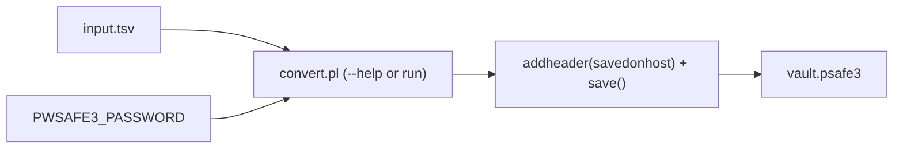

# Tutorial 1: Converting a TSV File to a Password Safe Vault

In this tutorial, you validate the sample `input.tsv` fixture, inspect `convert.pl` help output, and run the container conversion workflow safely without overwriting existing vault files.

## Prerequisites

- Docker installed to build and run the `psafe3` container, or Perl 5 with `Crypt::PWSafe3` installed locally.
- Clean working directory containing your target `.tsv` file.

## Step 1: Verify the Sample TSV Structure

Inspect `input.tsv`. Group headers use `GROUP:<NAME>` and credential lines use **five tab-separated columns**:

```text
GROUP:APP_TESTING
appbddlir1	calcul	apps_ro	ro	azeazezaedsd
```

Validate that every non-group line in `input.tsv` splits cleanly into five tab-delimited columns:

```bash
python3 -c "import pathlib; rows=[l.split('\t') for l in pathlib.Path('input.tsv').read_text().splitlines() if l.strip() and not l.startswith('GROUP:')]; assert len(rows)==4 and all(len(r)==5 for r in rows); print('Valid TSV rows:', len(rows))"
```

Expected output:

```text
Valid TSV rows: 4
```

## Step 2: Trace the Conversion Pipeline



Check `convert.pl` usage instructions inside the container:

```bash
docker build -t psafe3 .
docker run --rm psafe3 --help
```

## Step 3: Create a Vault Using `PWSAFE3_PASSWORD`

Pass the master passphrase through the `PWSAFE3_PASSWORD` environment variable so it stays out of shell arguments:

```bash
export PWSAFE3_PASSWORD="replace-with-strong-passphrase"
sh drun.sh input.tsv demo.psafe3
```

Because `convert.pl` checks `die ... if -e $output_file`, running the same output filename twice refuses to overwrite an existing `.psafe3` vault.

## Next Steps

- Operational procedures: [How to Build and Run the pwsafe3 Container](../02-how-to-guides/build-and-run-pwsafe3-container.md).
- Technical specifications: [CLI, TSV Schema, and Dockerfile Reference](../03-reference/cli-tsv-schema-and-dockerfile.md).
- Architecture notes: [Vault Format and Container Security](../04-explanation/vault-format-and-container-security.md).
