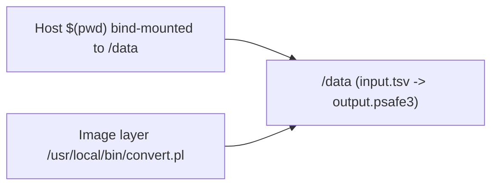

# Vault Format and Container Security

Three design choices shape how **pwsafe3** packages `Crypt::PWSafe3` and processes password exports.

## 1. Bind-Mount Isolation (`/usr/local/bin/convert.pl` vs `/data`)

Mounting the host working directory onto `/data` obscures any image files originally stored under `/data`. Placing `convert.pl` under `/usr/local/bin/convert.pl` ensures the container entrypoint remains reachable regardless of which host folder is bind-mounted at runtime. Running the container as unprivileged `USER app` alongside `--user "$(id -u):$(id -g)"` in `drun.sh` avoids root-owned vault files on Linux hosts.

## 2. Tab-Delimited (`input.tsv`) Parsing Over Comma CSV

Passwords and service descriptions frequently contain commas, quotes, or symbols. Splitting strictly on tabs (`\t`) while setting group labels from `GROUP:` prefix lines avoids quoted-CSV ambiguities for simple five-column exports.

## 3. Vault Header Persistence and Passphrase Hygiene

In `Crypt::PWSafe3`, `addheader()` modifies the in-memory vault object and must execute **before** `save()` flushes encrypted blocks to disk. Passing the passphrase via `PWSAFE3_PASSWORD` avoids exposing secrets in host `ps` output or shell history when compared to positional CLI argument `$3`.

- Exact parameter specification: [Reference](../03-reference/cli-tsv-schema-and-dockerfile.md).
- Operational usage: [How to Build and Run the pwsafe3 Container](../02-how-to-guides/build-and-run-pwsafe3-container.md).
