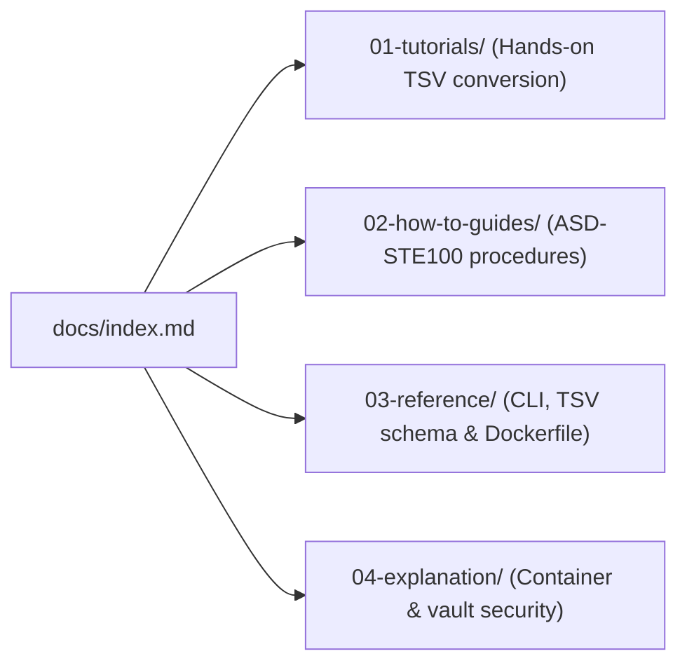

# pwsafe3 Documentation Portal

Welcome to the **pwsafe3** documentation portal organized under the **Diátaxis** framework.

> **Repository Overview:** [README.md](../README.md)

## Quadrants

| Quadrant | Purpose | Entry Point |
| :--- | :--- | :--- |
| **Tutorials** | Guided TSV-to-vault walkthroughs | [01-tutorials/index.md](01-tutorials/index.md) |
| **How-To Guides** | Step-by-step operational procedures (ASD-STE100 Issue 9) | [02-how-to-guides/index.md](02-how-to-guides/index.md) |
| **Reference** | CLI flags, environment variables, TSV columns, and `Dockerfile` spec | [03-reference/index.md](03-reference/index.md) |
| **Explanation** | Design choices around bind mounts, headers, and credential handling | [04-explanation/index.md](04-explanation/index.md) |
